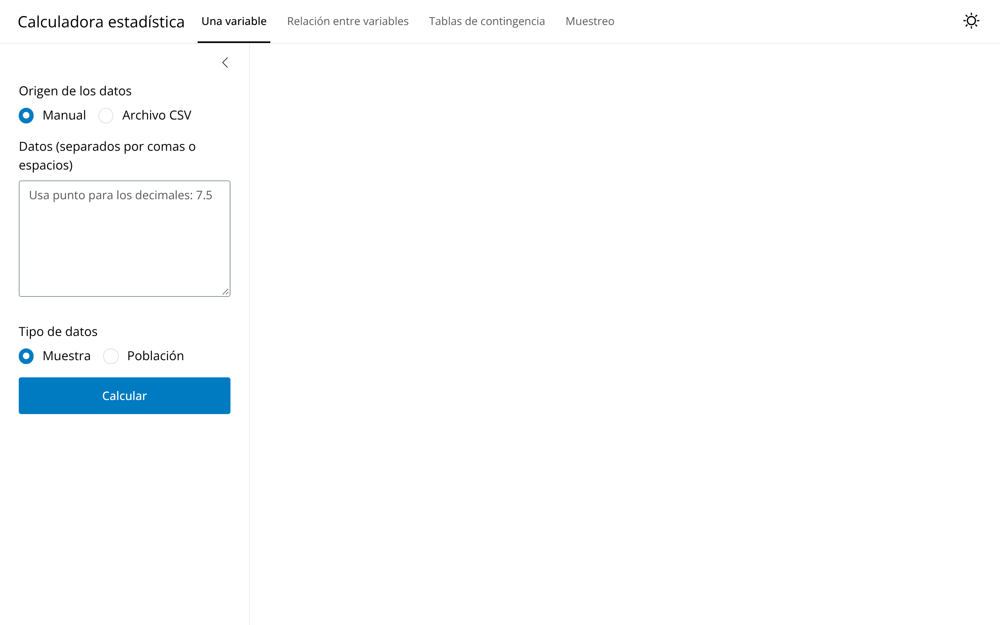
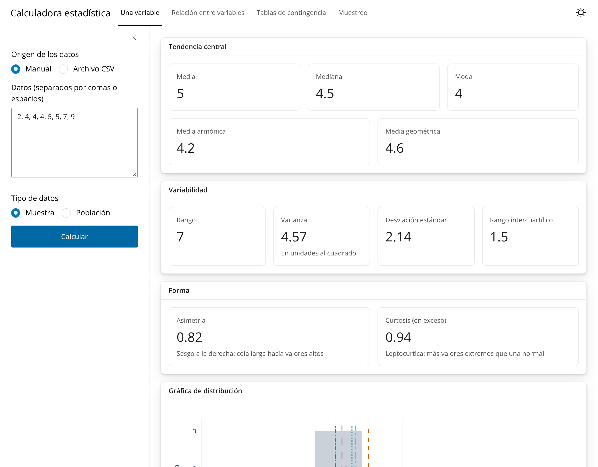
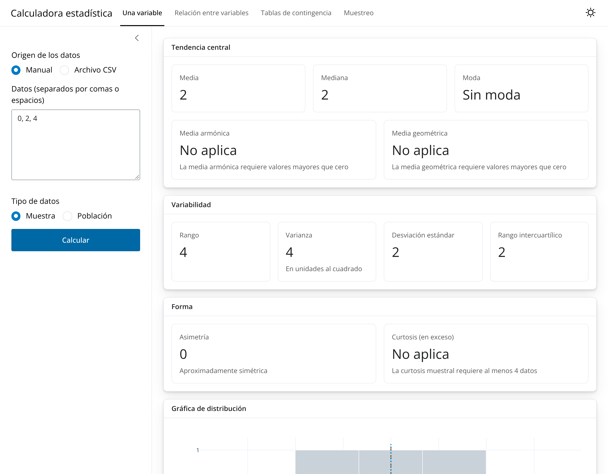
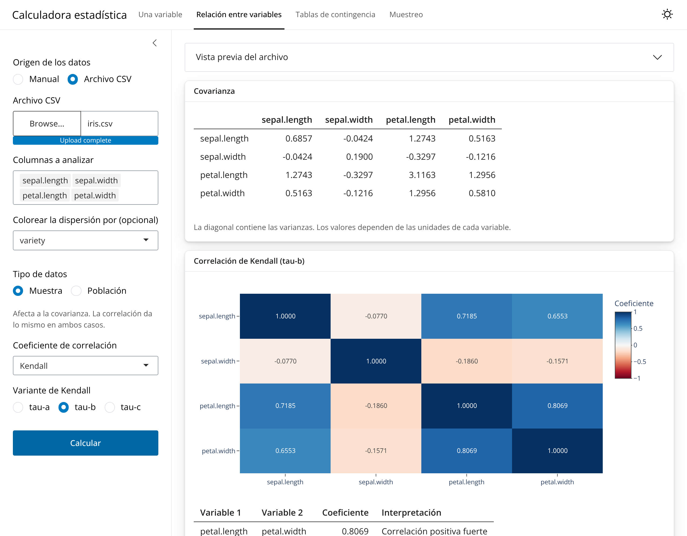
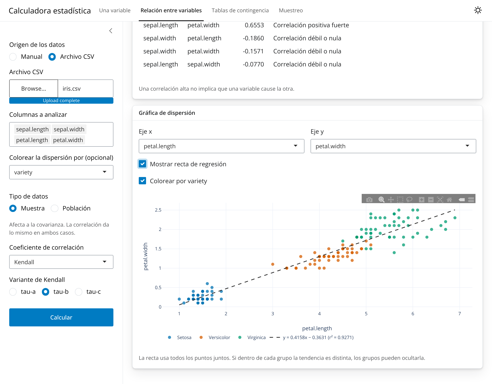
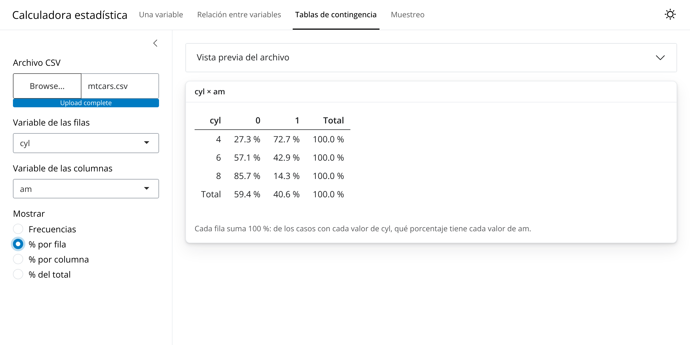
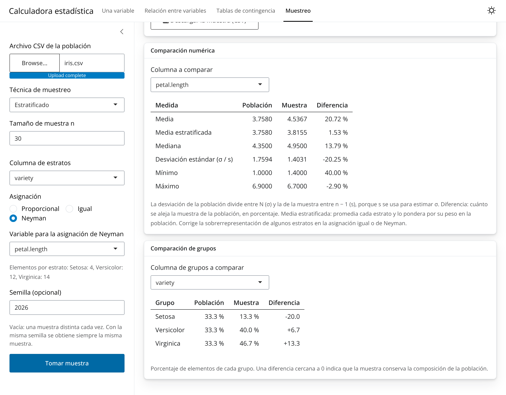
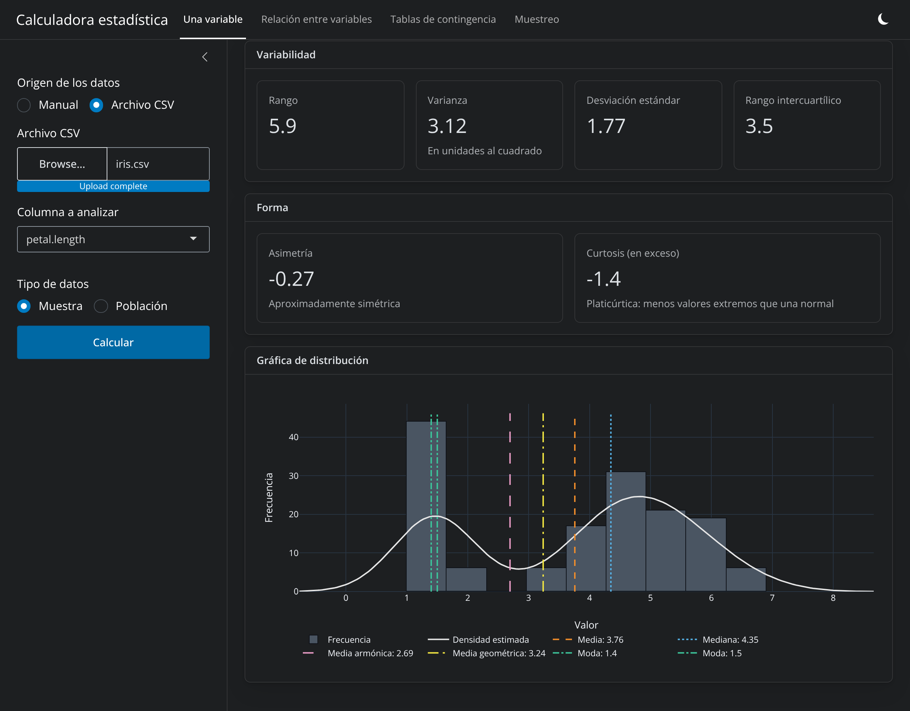

```{r}
#| include: false
# Configuración: carga el paquete desde la carpeta del proyecto, sin
# instalarlo, con sus funciones internas visibles.
pkgload::load_all("..", quiet = TRUE, export_all = TRUE)

# En PDF y Word, las gráficas interactivas se convierten en imágenes con
# webshot2, que usa Google Chrome.
knitr::opts_chunk$set(fig.width = 8, fig.height = 4.5, screenshot.opts = list(delay = 1))

# Conjunto de datos usado en la mayoría de las pruebas.
D <- c(2, 4, 4, 4, 5, 5, 7, 9)

IRIS <- leer_csv("../datos_prueba/iris.csv")
MTCARS <- leer_csv("../datos_prueba/mtcars.csv")

#' Tabla Markdown a partir de un data.frame
#'
#' En PDF, el ancho de cada columna sale de la cantidad de guiones de la
#' línea que separa el encabezado: `anchos` los reparte en proporción.
tabla_md <- function(tabla, anchos = NULL, alinear = NULL) {
  if (is.null(anchos)) {
    anchos <- rep(1, ncol(tabla))
  }
  if (is.null(alinear)) {
    alinear <- rep("l", ncol(tabla))
  }
  guiones <- pmax(3, round(60 * anchos / sum(anchos)))
  separador <- vapply(seq_along(guiones), function(i) {
    linea <- strrep("-", guiones[i])
    if (alinear[i] == "r") paste0(linea, ":") else linea
  }, character(1))
  limpiar <- function(v) gsub("\n", " ", gsub("\\|", "\\\\|", as.character(v)))
  filas <- apply(tabla, 1, function(f) paste0("| ", paste(limpiar(f), collapse = " | "), " |"))
  knitr::asis_output(paste(c(
    paste0("| ", paste(names(tabla), collapse = " | "), " |"),
    paste0("|", paste(separador, collapse = "|"), "|"),
    filas
  ), collapse = "\n"))
}

#' Gráfica de plotly: interactiva en HTML, imagen de tamaño fijo en PDF y Word
#'
#' webshot2 abre la gráfica en Chrome y toma una captura del tamaño
#' indicado, con el doble de resolución.
figura <- function(fig, ancho = 900, alto = 450) {
  if (knitr::is_html_output()) {
    return(fig)
  }
  fig <- plotly::layout(fig, width = ancho, height = alto, margin = list(t = 30), font = list(size = 14))
  fig <- plotly::config(fig, displayModeBar = FALSE)
  fig$sizingPolicy$browser$padding <- 0
  html <- tempfile(fileext = ".html")
  htmlwidgets::saveWidget(fig, html, selfcontained = FALSE)
  imagen <- knitr::fig_path(".png")
  dir.create(dirname(imagen), recursive = TRUE, showWarnings = FALSE)
  webshot2::webshot(html, imagen, vwidth = ancho, vheight = alto, zoom = 2, delay = 1, quiet = TRUE)
  knitr::include_graphics(imagen)
}

#' Muestra las funciones de un archivo de R/, con su firma y su resumen
#'
#' Lee el archivo, busca cada "nombre <- function(" y toma la primera
#' línea del bloque roxygen que la precede.
funciones <- function(archivo) {
  lineas <- readLines(file.path("..", "R", archivo), encoding = "UTF-8")
  inicios <- grep("^[A-Za-z_.][A-Za-z0-9_.]* <- function\\(", lineas)

  filas <- lapply(inicios, function(i) {
    nombre <- sub(" <- function.*", "", lineas[i])
    bloque <- character(0)
    j <- i - 1
    while (j >= 1 && startsWith(lineas[j], "#'")) {
      bloque <- c(lineas[j], bloque)
      j <- j - 1
    }
    argumentos <- formals(get(nombre, envir = asNamespace("estadistica")))
    partes <- vapply(names(argumentos), function(a) {
      # Un argumento sin valor por defecto se representa como un símbolo vacío.
      texto <- paste(deparse(argumentos[[a]]), collapse = "")
      if (texto == "") a else paste(a, "=", texto)
    }, character(1))
    data.frame(
      "Función" = sprintf("`%s(%s)`", nombre, paste(partes, collapse = ", ")),
      "Qué hace" = sub("^#' ?", "", bloque[1]),
      "Uso" = if (any(grepl("@export", bloque))) "Exportada" else "Interna",
      check.names = FALSE
    )
  })
  tabla_md(do.call(rbind, filas), anchos = c(46, 44, 10))
}

#' Ejecuta un cálculo; si lanza error_estadistica, devuelve el mensaje
obtener <- function(calculo) {
  tryCatch(calculo, error_estadistica = function(e) paste("error_estadistica:", conditionMessage(e)))
}

#' Texto para mostrar un valor en la tabla de pruebas
mostrar <- function(valor) {
  if (is.character(valor) && length(valor) == 1) {
    return(valor)
  }
  if (is.numeric(valor) && length(valor) == 1 && is.null(names(valor))) {
    return(sprintf("%.4f", valor))
  }
  paste(deparse(valor, width.cutoff = 500), collapse = " ")
}

#' Compara lo obtenido con lo esperado
coincide <- function(obtenido, esperado) {
  if (identical(esperado, "error")) {
    return(is.character(obtenido) && startsWith(obtenido[1], "error_estadistica"))
  }
  if (is.numeric(esperado) && is.numeric(obtenido)) {
    return(length(obtenido) == length(esperado) &&
      all(abs(unname(obtenido) - unname(esperado)) <= 5e-5))
  }
  isTRUE(all.equal(obtenido, esperado, check.attributes = FALSE))
}

#' Ejecuta casos list(función, datos, cálculo, esperado) y muestra la tabla
#'
#' El cálculo se escribe con quote() para evaluarlo dentro de obtener().
pruebas <- function(...) {
  casos <- list(...)
  filas <- lapply(casos, function(caso) {
    obtenido <- obtener(eval(caso[[3]]))
    ok <- coincide(obtenido, caso[[4]])
    data.frame(
      "Función" = paste0("`", caso[[1]], "`"),
      "Datos" = caso[[2]],
      "Esperado" = mostrar(caso[[4]]),
      "Obtenido" = mostrar(obtenido),
      "Coincide" = if (ok) "Sí" else "**No**",
      check.names = FALSE
    )
  })
  tabla <- do.call(rbind, filas)
  correctos <- sum(tabla$Coincide == "Sí")
  knitr::asis_output(paste0(
    tabla_md(tabla, anchos = c(26, 22, 17, 27, 8)),
    sprintf("\n\n**%d de %d casos coinciden.**\n", correctos, nrow(tabla))
  ))
}
```

# Introducción

La Calculadora estadística en R es la traducción a R de la aplicación desarrollada antes en Python. Calcula medidas descriptivas de una variable y medidas de relación entre varias variables, construye tablas de contingencia, aplica técnicas de muestreo y presenta los resultados con gráficas interactivas. Se desarrolló como proyecto de la Maestría en Sistemas Computacionales (TecNM, campus Apizaco).

La traducción no consistió en reescribir línea por línea. pandas y R base tienen convenciones distintas (por ejemplo, `var()` de R siempre divide entre $n - 1$), y Streamlit y Shiny tienen modelos de ejecución opuestos. Cada diferencia se resolvió de forma explícita para que las dos versiones den los mismos resultados, y el capítulo 10 las documenta.

## Objetivos

**Objetivo general.** Traducir a R la Calculadora estadística, como un paquete con aplicación Shiny, conservando sus resultados y documentando las decisiones que exige cada lenguaje.

**Objetivos específicos.**

1. Implementar en R base las medidas de tendencia central, forma y variabilidad, con opción muestral o poblacional.
2. Implementar la covarianza, los coeficientes de Pearson, Spearman, Kendall (tau-a, tau-b y tau-c) y gamma, la recta de regresión y las tablas de contingencia.
3. Implementar las técnicas de muestreo probabilístico y por cuotas, y el cálculo del tamaño de muestra.
4. Recibir datos por captura manual y por archivo CSV, validarlos e informar cuántos se descartaron.
5. Construir la interfaz con Shiny y bslib, con las mismas cuatro pantallas y gráficas de plotly.
6. Comprobar con pruebas automatizadas (testthat) que los resultados coinciden con los de la versión en Python.
7. Comparar las técnicas de muestreo con la población en los conjuntos Iris y mtcars.

## Herramientas

| Herramienta | Uso en el proyecto |
| --- | --- |
| R 4.6.2 | Lenguaje de la aplicación |
| R base y `stats` | Todos los cálculos, sin paquetes estadísticos externos |
| Shiny y bslib | Interfaz web: pestañas, barras laterales, tarjetas y tema oscuro |
| plotly | Gráficas de distribución y dispersión, y mapa de calor interactivos |
| withr | Semilla local en el muestreo, sin cambiar el generador aleatorio global |
| roxygen2 | Documentación de las funciones a partir de comentarios `#'` |
| testthat | Pruebas automatizadas (anexo A) |
| renv | Biblioteca de paquetes propia del proyecto y archivo `renv.lock` |
| Git y GitHub | Control de versiones |
| Positron | Entorno de desarrollo (sección 1.4) |
| Quarto, knitr y webshot2 | Este reporte: ejecuta el código del paquete y genera HTML, PDF y Word |

## Entorno de desarrollo

El proyecto se desarrolló en **Positron**, el entorno de desarrollo integrado (IDE) de Posit para ciencia de datos. Positron está construido sobre Code OSS, la base de Visual Studio Code, y trabaja con R y Python en el mismo programa: la versión en Python de esta aplicación se desarrolló en el mismo entorno.

| Elemento | Versión |
| --- | --- |
| Positron | 2026.11.1 (build 4) |
| Code OSS | 1.138.0 |
| Sistema operativo | macOS (Apple Silicon, arm64) |
| R | 4.6.2, con la biblioteca del proyecto administrada por renv |
| Quarto | 1.10.18 |

Las funciones de Positron que se usaron en el desarrollo:

| Función | Uso en el proyecto |
| --- | --- |
| Selector de intérprete | Elegir R 4.6.2 para este proyecto, en lugar del Python del proyecto anterior |
| Consola de R | Probar cada función con `pkgload::load_all()` antes de integrarla a la interfaz |
| Panel de ayuda | Revisar la documentación generada por roxygen2 con `?limpiar_serie` |
| Panel de variables y explorador de datos | Inspeccionar los `data.frame` de iris y mtcars |
| Visor (Viewer) | Ejecutar la aplicación Shiny con `shiny::runApp()` |
| Terminal integrada | Ejecutar `git` y `quarto render` |
| Soporte de Quarto | Editar y renderizar este reporte desde el mismo entorno |

# Arquitectura

La aplicación es un **paquete de R**: una estructura estándar con un archivo `DESCRIPTION` que declara sus dependencias, el código en `R/`, la documentación en `man/` y las pruebas en `tests/`. Las capas son las mismas que en Python: entradas, validación, cálculos, muestreo e interfaz.

```{mermaid}
%%| fig-width: 6
flowchart LR
  E["<b>Entradas</b><br/>entradas_manual.R<br/>entradas_csv.R"]
  V["<b>validacion.R</b><br/>limpiar_serie<br/>limpiar_tabla"]
  K["<b>Cálculos</b><br/>calculos_centralidad.R<br/>calculos_forma.R<br/>calculos_variabilidad.R<br/>calculos_relacion.R"]
  M["<b>muestreo.R</b><br/>técnicas y<br/>tamaño de muestra"]
  I["<b>Interfaz</b><br/>interfaz_app.R<br/>una pantalla por archivo<br/>interfaz_graficas.R"]
  E --> V --> K --> I
  E --> M --> I
```

R no admite subcarpetas dentro de `R/`, así que la organización de Python en carpetas (`entradas/`, `calculos/`, `interfaz/`) se convirtió en **prefijos** en el nombre de cada archivo. Cada archivo de R corresponde a un archivo de Python.

| Ubicación | Contenido |
| --- | --- |
| `app.R` | Punto de arranque: `shiny::runApp()` |
| `DESCRIPTION` | Nombre del paquete, autor y dependencias |
| `R/entradas_*.R` | Captura manual y lectura de CSV (capítulo 3) |
| `R/errores.R`, `R/validacion.R` | Clase de error y limpieza de los datos (capítulo 4) |
| `R/calculos_*.R` | Las medidas estadísticas (capítulos 5 a 7) |
| `R/muestreo.R` | Técnicas de muestreo y tamaño de muestra (capítulo 8) |
| `R/interfaz_*.R` | Pantallas, gráficas y formato (capítulo 9) |
| `tests/testthat/` | Pruebas automatizadas (anexo A) |
| `datos_prueba/` | `iris.csv`, `mtcars.csv` y `ejemplo.csv` |
| `docs/` | Este reporte |

**Principio de diseño.** Cada regla vive en un solo lugar, igual que en Python: `desviacion_estandar` reutiliza `varianza`, y `correlacion_spearman` reutiliza `correlacion_pearson`.

**Manejo de errores.** Python usaba `ValueError`. En R, los errores causados por los datos se lanzan con la clase propia `error_estadistica`, definida en `errores.R`. La interfaz atrapa solo esa clase y muestra "No aplica" con el motivo; cualquier otro error se considera un error del programa y no se oculta.

```{r}
funciones("errores.R")
```

# Entradas

Las entradas obtienen los datos tal como llegan, sin convertirlos a número.

## `entradas_manual.R`

```{r}
funciones("entradas_manual.R")
```

`desde_texto` separa el texto con la expresión regular `[,;[:space:]]+`, la forma estándar en R de `[,;\s]+`: comas, punto y coma, espacios o saltos de línea. Después descarta los fragmentos vacíos. Como la coma es separador, los decimales se escriben con punto.

## `entradas_csv.R`

```{r}
funciones("entradas_csv.R")
```

`leer_csv` recibe una **ruta**, que es lo que entrega `fileInput` de Shiny; en Python recibía el archivo abierto que entregaba Streamlit.

- **Codificación.** Lee los bytes del archivo, quita la marca BOM que agrega Excel y prueba UTF-8; si el texto no es UTF-8 válido, `iconv` devuelve `NA` y se usa Latin-1.
- **Separador.** Cuenta cuántas veces aparece cada separador permitido (coma, punto y coma, tabulador y barra vertical) en las primeras 20 líneas, y elige el primero que aparece el mismo número de veces en todas. Si ninguno cumple, el archivo es de una sola columna.
- **Celdas vacías.** Se leen como dato faltante (`na.strings = c("", "NA")`), igual que en pandas. Sin esa opción, `read.csv` convierte una celda vacía de una columna de texto en `""`, que contaría como un grupo más.

## Pruebas

```{r}
pruebas(
  list("desde_texto", '`"8, 9 7.5\\n10"`', quote(desde_texto("8, 9 7.5\n10")), c("8", "9", "7.5", "10")),
  list("desde_texto", '"  8, 9, 7, "', quote(desde_texto("  8, 9, 7, ")), c("8", "9", "7")),
  list("desde_texto", '""', quote(desde_texto("")), character(0)),
  list("leer_csv", "ejemplo.csv (filas, columnas)",
       quote(dim(leer_csv("../datos_prueba/ejemplo.csv"))), c(7, 3)),
  list("leer_csv", "iris.csv (filas, columnas)", quote(dim(IRIS)), c(150, 5)),
  list("leer_csv", "mtcars.csv (filas, columnas)", quote(dim(MTCARS)), c(32, 12)),
  list("leer_csv", "una sola columna", quote({
    ruta <- tempfile(); writeLines(c("x", "1", "2"), ruta); dim(leer_csv(ruta))
  }), c(2, 1)),
  list("leer_csv", "acentos en Latin-1", quote({
    ruta <- tempfile(); writeBin(iconv("nombre\nMaría\n", "UTF-8", "latin1", toRaw = TRUE)[[1]], ruta)
    leer_csv(ruta)[1, 1]
  }), "María"),
  list("leer_csv", "archivo vacío", quote({
    ruta <- tempfile(); file.create(ruta); leer_csv(ruta)
  }), "error")
)
```

# Validación

## `validacion.R`

```{r}
funciones("validacion.R")
```

Las reglas son las mismas que en Python: en una variable se descartan los valores no numéricos y se avisa cuántos; en varias variables se descarta la fila completa, para que todos los coeficientes se calculen sobre las mismas filas.

| Python | R | Comentario |
| --- | --- | --- |
| `pd.to_numeric(errors="coerce")` | `a_numero()`: `as.numeric(as.character(x))` | El `as.character` evita un error clásico de R: un *factor* convertido con `as.numeric` da su código interno (1, 2, 3…), no su valor |
| Tupla `(serie, descartados)` | Lista `list(datos =, descartados =)` | R no tiene tuplas |
| `.reset_index(drop=True)` | `rownames(limpia) <- NULL` | Los vectores de R no tienen índice; las tablas vuelven a numerar sus filas |
| `filas.index` (desde 0) | `which(complete.cases(...))` (desde 1) | R cuenta las posiciones desde 1 |

## Pruebas

```{r}
EJEMPLO <- leer_csv("../datos_prueba/ejemplo.csv")
pruebas(
  list("limpiar_serie", '"8", "9", "diez", "7", ""',
       quote(unlist(limpiar_serie(c("8", "9", "diez", "7", "")))),
       c(datos1 = 8, datos2 = 9, datos3 = 7, descartados = 2)),
  list("limpiar_serie", '"a", "b"', quote(limpiar_serie(c("a", "b"))), "error"),
  list("limpiar_serie", 'factor("10", "20")', quote(limpiar_serie(factor(c("10", "20")))$datos), c(10, 20)),
  list("limpiar_tabla", "ejemplo.csv: calificación y edad (filas, descartadas)",
       quote({ r <- limpiar_tabla(EJEMPLO[c("calificacion", "edad")]); c(nrow(r$datos), r$descartadas) }),
       c(6, 1)),
  list("filas_completas", "ejemplo.csv: calificación y edad",
       quote(filas_completas(EJEMPLO[c("calificacion", "edad")])), c(1, 2, 3, 5, 6, 7)),
  list("limpiar_tabla", "iris.csv con la columna de texto",
       quote(limpiar_tabla(IRIS[c("sepal.length", "variety")])), "error")
)
```

`filas_completas` da 1, 2, 3, 5, 6 y 7, mientras que en Python daba 0, 1, 2, 4, 5 y 6: son las mismas filas, numeradas desde 1.

# Tendencia central y forma

Las medidas de tendencia central responden dónde se concentran los datos; las de forma, qué figura tiene su distribución. En este capítulo, $x_1, \dots, x_n$ son los datos, $n$ su cantidad y $\bar{x}$ su media.

## Teoría

**Media aritmética.** Suma de los valores entre su cantidad:

$$\bar{x} = \frac{1}{n}\sum_{i=1}^{n} x_i$$

**Mediana.** Valor central de los datos ordenados; con $n$ par, promedio de los dos centrales.

**Moda.** Valor o valores con mayor frecuencia. Si ningún valor se repite, no hay moda.

**Media armónica y geométrica.** Solo se definen con valores positivos. La geométrica se calcula por logaritmos para evitar el desbordamiento del producto:

$$H = \frac{n}{\sum_{i=1}^{n} \frac{1}{x_i}} \qquad G = \exp\left(\frac{1}{n}\sum_{i=1}^{n} \ln x_i\right)$$

**Asimetría y curtosis en exceso.** Versiones poblacionales ($g_1$, $g_2$) y con corrección muestral ($G_1$, $G_2$):

$$g_1 = \frac{m_3}{m_2^{3/2}} \qquad G_1 = g_1 \frac{\sqrt{n(n-1)}}{n-2} \qquad g_2 = \frac{m_4}{m_2^{2}} - 3 \qquad G_2 = \frac{n-1}{(n-2)(n-3)}\left[(n+1)\,g_2 + 6\right]$$

donde $m_k = \frac{1}{n}\sum (x_i - \bar{x})^k$ es el momento central de orden $k$.

## `calculos_centralidad.R`

```{r}
funciones("calculos_centralidad.R")
```

## `calculos_forma.R`

```{r}
funciones("calculos_forma.R")
```

## Decisiones de diseño

| Decisión | Opciones consideradas | Elegida | Razón |
| --- | --- | --- | --- |
| Moda | `table()`; `unique` con `tabulate(match())` | `tabulate(match())` | `table()` convierte los números a texto para contarlos y puede agrupar mal valores decimales |
| Asimetría y curtosis | Paquetes `e1071` o `moments`; fórmulas propias | Fórmulas propias | R base no las incluye, y cada paquete usa por defecto una fórmula distinta a la de pandas y Excel |
| Momentos centrales | Calcularlos en cada función; función común | `momentos_centrales()` interna | La asimetría y la curtosis usan los mismos momentos |
| Datos no válidos | `NA`; error | `error_estadistica` | Un `NA` falla lejos de la causa; el mensaje llega al usuario |

En Python, `skew()` y `kurt()` de pandas hacían la corrección muestral por dentro. En R las fórmulas quedan escritas en el código, así que la corrección se puede leer y comparar con la teoría.

## Pruebas

Con $D$ = 2, 4, 4, 4, 5, 5, 7, 9:

```{r}
pruebas(
  list("media", "D", quote(media(D)), 5),
  list("mediana", "D", quote(mediana(D)), 4.5),
  list("moda", "D", quote(moda(D)), 4),
  list("moda", "1, 1, 2, 2, 3", quote(moda(c(1, 1, 2, 2, 3))), c(1, 2)),
  list("moda", "1, 2, 3", quote(moda(c(1, 2, 3))), numeric(0)),
  list("media_armonica", "60, 40", quote(media_armonica(c(60, 40))), 48),
  list("media_armonica", "5, 0, 3", quote(media_armonica(c(5, 0, 3))), "error"),
  list("media_geometrica", "2, 8", quote(media_geometrica(c(2, 8))), 4),
  list("media_geometrica", "200 valores iguales a 100", quote(media_geometrica(rep(100, 200))), 100),
  list("asimetria", "D, muestral", quote(asimetria(D)), 0.8185),
  list("asimetria", "D, poblacional", quote(asimetria(D, muestral = FALSE)), 0.65625),
  list("asimetria", "5, 5, 5", quote(asimetria(c(5, 5, 5))), "error"),
  list("curtosis", "D, muestral", quote(curtosis(D)), 0.940625),
  list("curtosis", "D, poblacional", quote(curtosis(D, muestral = FALSE)), -0.21875),
  list("curtosis", "1, 2, 3, muestral", quote(curtosis(c(1, 2, 3))), "error")
)
```

Con $D$, la curtosis cambia de clasificación según la versión: la muestral es leptocúrtica y la poblacional mesocúrtica.

# Variabilidad

## Teoría

**Rango.** Diferencia entre el valor máximo y el mínimo.

**Varianza.** Promedio de los cuadrados de las desviaciones respecto a la media. La versión muestral divide entre $n - 1$:

$$\sigma^2 = \frac{\sum (x_i - \bar{x})^2}{n} \qquad s^2 = \frac{\sum (x_i - \bar{x})^2}{n - 1}$$

**Desviación estándar.** Raíz cuadrada de la varianza, en las mismas unidades que los datos.

**Rango intercuartílico.** $Q_3 - Q_1$: la dispersión de la mitad central, sin efecto de los valores extremos.

## `calculos_variabilidad.R`

```{r}
funciones("calculos_variabilidad.R")
```

## Decisiones de diseño

| Decisión | Opciones consideradas | Elegida | Razón |
| --- | --- | --- | --- |
| Varianza | `stats::var()` ajustada; fórmula con `ddof` | Fórmula con `ddof` | `var()` siempre divide entre $n - 1$ y no tiene `ddof`; además, con un solo dato da `NA`, cuando la varianza poblacional es 0 |
| Cuartiles | Los 9 tipos de `quantile()` | `stats::IQR(type = 7)` | El tipo 7 es la interpolación lineal de pandas, numpy y `CUARTIL.INC` de Excel |
| Desviación estándar | `stats::sd()`; reutilizar `varianza` | Raíz de `varianza` | Hereda su validación y su `ddof` |

## Pruebas

```{r}
D_EXTREMO <- c(2, 4, 4, 4, 5, 5, 7, 900)
pruebas(
  list("rango", "D", quote(rango(D)), 7),
  list("varianza", "D, muestral", quote(varianza(D)), 4.5714),
  list("varianza", "D, poblacional", quote(varianza(D, muestral = FALSE)), 4),
  list("varianza", "7, muestral", quote(varianza(7)), "error"),
  list("varianza", "7, poblacional", quote(varianza(7, muestral = FALSE)), 0),
  list("desviacion_estandar", "D, muestral", quote(desviacion_estandar(D)), 2.1381),
  list("desviacion_estandar", "D, poblacional", quote(desviacion_estandar(D, muestral = FALSE)), 2),
  list("rango_intercuartilico", "D", quote(rango_intercuartilico(D)), 1.5),
  list("rango_intercuartilico", "D con 900 en lugar de 9", quote(rango_intercuartilico(D_EXTREMO)), 1.5)
)
```

# Relación entre variables

## Teoría

**Covarianza y Pearson.** La covarianza promedia el producto de las desviaciones; la correlación de Pearson la divide entre el producto de las desviaciones estándar y mide la relación lineal entre $-1$ y $1$:

$$\operatorname{cov}(x, y) = \frac{\sum (x_i - \bar{x})(y_i - \bar{y})}{n - \text{ddof}} \qquad r = \frac{\operatorname{cov}(x, y)}{s_x \, s_y}$$

**Spearman.** Pearson aplicado a los rangos; a los empates se les asigna el rango promedio.

**Kendall y gamma.** Comparan todos los pares de observaciones: concordantes ($C$), discordantes ($D$) y empatados en $x$ ($T_x$) o en $y$ ($T_y$). Con $n_0 = n(n-1)/2$ y $m$ la menor cantidad de valores distintos entre las dos variables:

$$\tau_a = \frac{C - D}{n_0} \qquad \tau_b = \frac{C - D}{\sqrt{(n_0 - T_x)(n_0 - T_y)}} \qquad \tau_c = \frac{2m(C - D)}{n^2(m - 1)} \qquad \gamma = \frac{C - D}{C + D}$$

**Recta de regresión.** $y = a + b\,x$, con $b = \operatorname{cov}(x, y)/s_x^2$ y $a = \bar{y} - b\,\bar{x}$; $r^2$ es el cuadrado de Pearson.

**Tabla de contingencia.** Cruza dos variables categóricas y cuenta cada combinación, con totales por fila y por columna, en frecuencias o en porcentaje por fila, por columna o del total.

## `calculos_relacion.R`

```{r}
funciones("calculos_relacion.R")
```

## Decisiones de diseño

| Decisión | Opciones consideradas | Elegida | Razón |
| --- | --- | --- | --- |
| Conteo de pares | Dos ciclos, como en Python; matrices con `outer()`; un ciclo y comparación vectorizada | Un ciclo y comparación vectorizada | En R los ciclos son lentos; `outer()` ocuparía unos 800 MB con 10 000 datos. Con un ciclo, 5 000 datos tardan menos de un segundo |
| Matriz de covarianza | `stats::cov()`; álgebra matricial | `crossprod()` de los datos centrados | `cov()` siempre divide entre $n - 1$ |
| Matriz de correlación | `cor()`; ciclo sobre los pares de columnas | Ciclo sobre los pares | `cor()` no admite Kendall a, c ni gamma; el ciclo calcula la mitad de arriba y la copia |
| Tabla de contingencia | Conteo manual; `table()` y `addmargins()` | `table()` y `addmargins()` | Es la forma habitual en R e ignora los valores vacíos |
| Porcentajes | Dividir a mano; `sweep()` | `sweep()` | Divide cada fila o columna entre su total en una línea |
| Diccionarios de Python | Listas con nombres | `UMBRALES_CORRELACION` y `METODOS_CORRELACION` | Equivalen a los diccionarios y la interfaz obtiene de ellos las opciones |

## Pruebas

Con $x$ = 2, 4, 6, 8 y $y$ = 1, 3, 2, 5, sin empates, y con $x_e$ = 1, 2, 2, 3 y $y_e$ = 1, 2, 3, 3, con empates:

```{r}
X <- c(2, 4, 6, 8); Y <- c(1, 3, 2, 5)
XE <- c(1, 2, 2, 3); YE <- c(1, 2, 3, 3)
pruebas(
  list("covarianza", "x, y, muestral", quote(covarianza(X, Y)), 3.6667),
  list("covarianza", "x, y, poblacional", quote(covarianza(X, Y, muestral = FALSE)), 2.75),
  list("covarianza", "longitudes distintas", quote(covarianza(X, c(1, 2))), "error"),
  list("contar_pares", "x_e, y_e", quote(unlist(contar_pares(XE, YE))), c(C = 4, D = 0, Tx = 1, Ty = 1)),
  list("correlacion_pearson", "x, y", quote(correlacion_pearson(X, Y)), 0.8315),
  list("correlacion_spearman", "x, y", quote(correlacion_spearman(X, Y)), 0.8),
  list("correlacion_kendall", "x, y, tau-b", quote(correlacion_kendall(X, Y)), 0.6667),
  list("correlacion_gamma", "x, y", quote(correlacion_gamma(X, Y)), 0.6667),
  list("correlacion_pearson", "x_e, y_e", quote(correlacion_pearson(XE, YE)), 0.8528),
  list("correlacion_spearman", "x_e, y_e", quote(correlacion_spearman(XE, YE)), 0.8333),
  list("correlacion_kendall", "x_e, y_e, tau-a", quote(correlacion_kendall(XE, YE, "a")), 0.6667),
  list("correlacion_kendall", "x_e, y_e, tau-b", quote(correlacion_kendall(XE, YE, "b")), 0.8),
  list("correlacion_kendall", "x_e, y_e, tau-c", quote(correlacion_kendall(XE, YE, "c")), 0.75),
  list("correlacion_gamma", "x_e, y_e", quote(correlacion_gamma(XE, YE)), 1),
  list("correlacion_gamma", "x = 1, 1, 2, 2; y = 1, 2, 1, 2 (C = D = 1)",
       quote(correlacion_gamma(c(1, 1, 2, 2), c(1, 2, 1, 2))), 0),
  list("correlacion_kendall", "variante inexistente", quote(correlacion_kendall(X, Y, "d")), "error"),
  list("interpretar_correlacion", "0.55, Pearson", quote(interpretar_correlacion(0.55)),
       "Correlación positiva moderada"),
  list("interpretar_correlacion", "0.55, Kendall", quote(interpretar_correlacion(0.55, "kendall")),
       "Correlación positiva fuerte"),
  list("regresion_lineal", "mtcars: mpg contra wt, pendiente",
       quote(regresion_lineal(MTCARS$wt, MTCARS$mpg)$pendiente), -5.3445),
  list("regresion_lineal", "mtcars: mpg contra wt, intersección",
       quote(regresion_lineal(MTCARS$wt, MTCARS$mpg)$interseccion), 37.2851),
  list("regresion_lineal", "mtcars: mpg contra wt, r²",
       quote(regresion_lineal(MTCARS$wt, MTCARS$mpg)$r2), 0.7528),
  list("tabla_contingencia", "mtcars: cyl × am, total general",
       quote(tabla_contingencia(MTCARS, "cyl", "am")["Total", "Total"]), 32),
  list("tabla_contingencia", "mtcars: autos de 4 cil. manuales (am = 1)",
       quote(tabla_contingencia(MTCARS, "cyl", "am")["4", "1"]), 8),
  list("tabla_contingencia", "mtcars: % por fila, 4 cil. manuales",
       quote(tabla_contingencia(MTCARS, "cyl", "am", "fila")["4", "1"]), 72.7273),
  list("tabla_contingencia", "la misma variable en filas y columnas",
       quote(tabla_contingencia(MTCARS, "cyl", "cyl")), "error")
)
```

Además de los valores de Python, las pruebas automatizadas comparan Pearson, Spearman y Kendall b con `stats::cor()`, la recta con `lm()` y la matriz de covarianza con `stats::cov()`, que son implementaciones independientes de R.

## Aplicación al conjunto Iris

El archivo `iris.csv` contiene 4 medidas, en centímetros, de 150 flores de tres especies. Sus medidas tienen un decimal y se repiten mucho, así que los coeficientes basados en rangos y pares se separan de Pearson:

```{r}
NUMERICAS <- IRIS[1:4]
matrices <- list(
  "Pearson" = matriz_correlacion(NUMERICAS, "pearson"),
  "Spearman" = matriz_correlacion(NUMERICAS, "spearman"),
  "Kendall tau-b" = matriz_correlacion(NUMERICAS, "kendall", "b"),
  "Gamma" = matriz_correlacion(NUMERICAS, "gamma")
)
pares <- utils::combn(names(NUMERICAS), 2)
tabla <- data.frame(Par = paste(pares[1, ], "y", pares[2, ]), check.names = FALSE)
for (nombre in names(matrices)) {
  tabla[[nombre]] <- sprintf("%.4f", matrices[[nombre]][t(pares)])
}
tabla_md(tabla[order(-abs(as.numeric(tabla$Pearson))), ])
```

La relación entre el largo y el ancho del sépalo sale débil y negativa con los datos completos, pero dentro de cada especie es positiva:

```{r}
filas <- lapply(split(IRIS, IRIS$variety), function(grupo) {
  r <- correlacion_pearson(grupo$sepal.length, grupo$sepal.width)
  data.frame(Especie = grupo$variety[1], Flores = nrow(grupo),
             Pearson = sprintf("%.4f", r), "Interpretación" = interpretar_correlacion(r),
             check.names = FALSE)
})
r_total <- correlacion_pearson(IRIS$sepal.length, IRIS$sepal.width)
filas$total <- data.frame(Especie = "Las tres juntas", Flores = nrow(IRIS),
                          Pearson = sprintf("%.4f", r_total),
                          "Interpretación" = interpretar_correlacion(r_total), check.names = FALSE)
tabla_md(do.call(rbind, filas))
```

Este fenómeno es la **paradoja de Simpson**: mezclar grupos oculta la relación que existe dentro de cada uno. La gráfica de dispersión lo hace visible (@fig-dispersion-iris).

```{r}
#| label: fig-dispersion-iris
#| fig-cap: "Largo contra ancho del sépalo en Iris, coloreado por especie, con la recta de regresión de todas las flores juntas."
figura(grafica_dispersion(
  IRIS$sepal.length, IRIS$sepal.width, "sepal.length", "sepal.width",
  grupos = IRIS$variety,
  recta = regresion_lineal(IRIS$sepal.length, IRIS$sepal.width)
))
```

## Tabla de contingencia con mtcars

Se cruza el número de cilindros (`cyl`) con el tipo de transmisión (`am`: 0 automática, 1 manual).

```{r}
#| tbl-cap: "Frecuencias de cilindros por tipo de transmisión en mtcars."
tabla_md(tabla_visible(tabla_contingencia(MTCARS, "cyl", "am"), "cyl × am", NULL), alinear = c("l", "r", "r", "r"))
```

```{r}
#| tbl-cap: "Porcentaje por fila: de los autos con cada número de cilindros, qué proporción tiene cada transmisión."
tabla_md(tabla_visible(tabla_contingencia(MTCARS, "cyl", "am", "fila"), "cyl × am", "fila"), alinear = c("l", "r", "r", "r"))
```

La mayoría de los autos de 4 cilindros son manuales, y la gran mayoría de los de 8 son automáticos.

# Muestreo

En este capítulo, $N$ es el tamaño de la población, $n$ el de la muestra y, en las técnicas por grupos, $N_h$ y $n_h$ los tamaños del grupo $h$ en la población y en la muestra.

## Teoría

**Aleatorio simple.** Cada elemento tiene la misma probabilidad de ser elegido, sin reemplazo o con reemplazo.

**Sistemático.** Salto $k = \lfloor N / n \rfloor$, inicio al azar entre los primeros $k$ elementos y después cada $k$-ésimo elemento.

**Estratificado.** Se muestrea al azar dentro de cada estrato, con asignación proporcional, igual o de Neyman:

$$n_h^{\text{prop}} = n\,\frac{N_h}{N} \qquad n_h^{\text{igual}} = \frac{n}{H} \qquad n_h^{\text{Neyman}} = n\,\frac{N_h S_h}{\sum_k N_k S_k}$$

Las cuotas fraccionarias se redondean con el **método de los restos mayores**, para que sumen exactamente $n$. Si la asignación no es proporcional, la media se estima con la **media estratificada**:

$$\bar{x}_{\text{est}} = \sum_h \frac{N_h}{N}\,\bar{x}_h$$

**Por conglomerados.** Se eligen grupos completos al azar y se toman todos sus elementos.

**Por cuotas.** No probabilístico: se toman los primeros elementos de cada grupo, en el orden de los datos.

**Tamaño de muestra.** Para una media, para una proporción y con corrección para población finita:

$$n_0 = \left(\frac{z\,\sigma}{E}\right)^2 \qquad n_0 = \frac{z^2\,p(1-p)}{E^2} \qquad n = \frac{n_0}{1 + \frac{n_0 - 1}{N}}$$

## `muestreo.R`

```{r}
funciones("muestreo.R")
```

## Decisiones de diseño

| Decisión | Opciones consideradas | Elegida | Razón |
| --- | --- | --- | --- |
| Semilla | `set.seed()`; `withr::with_seed()`; guardar `.Random.seed` a mano | `withr::with_seed()` dentro de `con_semilla()` | `set.seed()` cambiaría el generador global de toda la sesión; con `with_seed` el generador queda como estaba |
| Sortear filas | `sample(x)`; `sample.int()` | `sample.int()` con posiciones | `sample(5, 1)` no devuelve 5, sino un número entre 1 y 5: con un conglomerado numérico único fallaría |
| Orden de los grupos | `table()` (alfabético); orden de aparición | Orden de aparición, con `contar_grupos()` | Igual que `value_counts(sort=False)`: en los empates de los restos mayores, los repartos coinciden con Python |
| Cuotas | Lista; vector con nombres | Vector con nombres: `c(Setosa = 5)` | Equivale al diccionario de Python |
| Valor $z$ | Tabla fija; `stats::qnorm()` | `stats::qnorm()` | Viene con R y acepta cualquier nivel de confianza |

**Diferencia con Python.** numpy usa el generador PCG64 y R el Mersenne-Twister, así que **con la misma semilla se eligen filas distintas**. Todo lo determinista coincide (asignación entre estratos, tamaños de muestra, cuotas y media estratificada sobre una misma muestra); lo aleatorio no.

## Pruebas

Las pruebas de las técnicas aleatorias revisan propiedades (tamaño, saltos y reproducibilidad), no filas concretas.

```{r}
ordenar <- function(x) x[order(as.numeric(names(x)))]
pruebas(
  list("muestreo_aleatorio_simple", "Iris, n = 30 (tamaño)",
       quote(nrow(muestreo_aleatorio_simple(IRIS, 30, semilla = 1))), 30),
  list("muestreo_aleatorio_simple", "Iris, misma semilla dos veces",
       quote(identical(muestreo_aleatorio_simple(IRIS, 30, semilla = 1),
                       muestreo_aleatorio_simple(IRIS, 30, semilla = 1))), TRUE),
  list("muestreo_aleatorio_simple", "mtcars, n = 40 con reemplazo",
       quote(nrow(muestreo_aleatorio_simple(MTCARS, 40, TRUE, 1))), 40),
  list("muestreo_aleatorio_simple", "mtcars, n = 40 sin reemplazo",
       quote(muestreo_aleatorio_simple(MTCARS, 40)), "error"),
  list("muestreo_sistematico", "Iris, n = 30: saltos entre filas",
       quote(unique(diff(as.integer(rownames(muestreo_sistematico(IRIS, 30, 1)))))), 5),
  list("asignar_estratos", "mtcars por cyl, n = 10, proporcional",
       quote(ordenar(asignar_estratos(MTCARS, "cyl", 10))), c("4" = 4, "6" = 2, "8" = 4)),
  list("asignar_estratos", "mtcars por cyl, n = 10, igual",
       quote(ordenar(asignar_estratos(MTCARS, "cyl", 10, "igual"))), c("4" = 3, "6" = 4, "8" = 3)),
  list("asignar_estratos", "mtcars por cyl, n = 10, Neyman con hp",
       quote(ordenar(asignar_estratos(MTCARS, "cyl", 10, "neyman", "hp"))), c("4" = 2, "6" = 2, "8" = 6)),
  list("asignar_estratos", "mtcars por cyl, n = 24, igual (6 cil. solo tiene 7)",
       quote(asignar_estratos(MTCARS, "cyl", 24, "igual")), "error"),
  list("muestreo_estratificado", "Iris por especie, n = 30, proporcional",
       quote(as.vector(table(muestreo_estratificado(IRIS, "variety", 30, semilla = 1)$variety))),
       c(10, 10, 10)),
  list("media_estratificada", "Iris completo como muestra",
       quote(media_estratificada(IRIS, IRIS, "variety", "petal.length")), mean(IRIS$petal.length)),
  list("media_estratificada", "muestra sin una especie",
       quote(media_estratificada(IRIS[IRIS$variety != "Setosa", ], IRIS, "variety", "petal.length")), "error"),
  list("muestreo_conglomerados", "mtcars, 5 de 3 grupos de gear",
       quote(muestreo_conglomerados(MTCARS, "gear", 5)), "error"),
  list("muestreo_cuotas", "Iris: 3 Setosa y 2 Virginica (filas)",
       quote(as.integer(rownames(muestreo_cuotas(IRIS, "variety", c(Setosa = 3, Virginica = 2))))),
       c(1, 2, 3, 101, 102)),
  list("muestreo_cuotas", "Iris: especie inexistente",
       quote(muestreo_cuotas(IRIS, "variety", c(Rosa = 2))), "error"),
  list("tamano_muestra_proporcion", "E = 0.05, 95 %", quote(tamano_muestra_proporcion(0.05)), 385),
  list("tamano_muestra_proporcion", "E = 0.05, 95 %, N = 500",
       quote(tamano_muestra_proporcion(0.05, poblacion = 500)), 218),
  list("tamano_muestra_media", "$\\sigma$ = 6, E = 2, 95 %", quote(tamano_muestra_media(6, 2)), 35),
  list("tamano_muestra_media", "confianza de 1.5", quote(tamano_muestra_media(6, 2, 1.5)), "error")
)
```

## Aplicación a Iris y mtcars

Las ocho variantes programadas se aplican a los dos conjuntos de datos y cada muestra se compara con la población, con los mismos parámetros y la misma semilla 2026 que en la versión en Python. Como el generador aleatorio de R es distinto, **las muestras y sus números no son los mismos que en el reporte de Python**; lo que se compara al final del capítulo son las conclusiones.

| | Iris | mtcars |
| --- | --- | --- |
| Población | 150 flores | 32 autos |
| Variable numérica | `petal.length` (largo del pétalo, cm) | `mpg` (millas por galón) |
| Estratos y cuotas | `variety` (3 especies de 50) | `cyl` (11, 7 y 14 autos con 4, 6 y 8 cilindros) |
| Conglomerados | `variety`: se elige 1 especie de 3 | `gear`: se elige 1 grupo de velocidades de 3 |
| Tamaño de muestra | $n = 30$ (20 %) | $n = 10$ (31 %) |

### Tamaño de muestra sugerido

Con 95 % de confianza y la desviación de la población:

```{r}
filas <- lapply(list(
  list("Iris", IRIS, "petal.length", 0.5, "cm"),
  list("mtcars", MTCARS, "mpg", 3, "mpg")
), function(caso) {
  sigma <- desviacion_estandar(caso[[2]][[caso[[3]]]], muestral = FALSE)
  data.frame(
    Datos = caso[[1]], "$\\sigma$" = sprintf("%.3f", sigma),
    "Margen de error E" = paste(caso[[4]], caso[[5]]),
    "n sin corrección" = tamano_muestra_media(sigma, caso[[4]]),
    "n con corrección finita" = tamano_muestra_media(sigma, caso[[4]], poblacion = nrow(caso[[2]])),
    check.names = FALSE
  )
})
tabla_md(do.call(rbind, filas))
```

Estos valores no dependen del azar, así que son los mismos que en Python.

```{r}
#| include: false
# Configuración de la comparación: las ocho variantes para cada conjunto de datos.
SEMILLA <- 2026
CASOS <- list(
  Iris = list(datos = IRIS, numerica = "petal.length", grupo = "variety",
              conglomerado = "variety", n = 30),
  mtcars = list(datos = MTCARS, numerica = "mpg", grupo = "cyl",
                conglomerado = "gear", n = 10)
)

#' Las ocho variantes como funciones que reciben una semilla
tecnicas <- function(caso) {
  d <- caso$datos; n <- caso$n; g <- caso$grupo; v <- caso$numerica
  cuotas <- asignar_estratos(d, g, n, "proporcional")
  list(
    "Aleatorio simple" = function(s) muestreo_aleatorio_simple(d, n, semilla = s),
    "Aleatorio simple con reemplazo" = function(s) muestreo_aleatorio_simple(d, n, TRUE, s),
    "Sistemático" = function(s) muestreo_sistematico(d, n, s),
    "Estratificado proporcional" = function(s) muestreo_estratificado(d, g, n, "proporcional", semilla = s),
    "Estratificado igual" = function(s) muestreo_estratificado(d, g, n, "igual", semilla = s),
    "Estratificado de Neyman" = function(s) muestreo_estratificado(d, g, n, "neyman", v, s),
    "Conglomerados (1 grupo)" = function(s) muestreo_conglomerados(d, caso$conglomerado, 1, s),
    "Cuotas" = function(s) muestreo_cuotas(d, g, cuotas)
  )
}

#' Media estratificada para las técnicas estratificadas; si no, la media simple
media_estimada <- function(nombre, muestra, caso) {
  if (startsWith(nombre, "Estratificado")) {
    return(media_estratificada(muestra, caso$datos, caso$grupo, caso$numerica))
  }
  media(muestra[[caso$numerica]])
}

#' Toma una muestra con cada técnica y la compara con la población
comparar <- function(caso) {
  d <- caso$datos; v <- caso$numerica; g <- caso$grupo
  mu <- media(d[[v]])
  grupos <- sort(unique(d[[g]]))
  porcentajes <- function(valores) {
    sprintf("%.0f %%", 100 * as.vector(table(factor(valores, levels = grupos))) / length(valores))
  }

  numericas <- data.frame(
    "Técnica" = "Población", n = nrow(d), Media = sprintf("%.3f", mu),
    "Media estratificada" = "—", "Diferencia de la estimación" = "—",
    Mediana = sprintf("%.3f", mediana(d[[v]])),
    "Desviación (s)" = sprintf("%.3f ($\\sigma$)", desviacion_estandar(d[[v]], muestral = FALSE)),
    check.names = FALSE
  )
  composicion <- data.frame(t(c("Población", porcentajes(d[[g]]))))
  puntos <- data.frame()

  for (nombre in names(tecnicas(caso))) {
    m <- tecnicas(caso)[[nombre]](SEMILLA)
    simple <- media(m[[v]])
    estimada <- media_estimada(nombre, m, caso)
    numericas <- rbind(numericas, data.frame(
      "Técnica" = nombre, n = nrow(m), Media = sprintf("%.3f", simple),
      "Media estratificada" = if (startsWith(nombre, "Estratificado")) sprintf("%.3f", estimada) else "—",
      "Diferencia de la estimación" = sprintf("%+.1f %%", 100 * (estimada - mu) / mu),
      Mediana = sprintf("%.3f", mediana(m[[v]])),
      "Desviación (s)" = sprintf("%.3f", desviacion_estandar(m[[v]])),
      check.names = FALSE
    ))
    composicion <- rbind(composicion, data.frame(t(c(nombre, porcentajes(m[[g]])))))
    puntos <- rbind(puntos, data.frame(nombre = nombre, simple = simple, estimada = estimada))
  }
  names(composicion) <- c("Técnica", paste(g, "=", grupos))
  list(numericas = numericas, composicion = composicion, puntos = puntos, mu = mu)
}

#' Media estimada por cada técnica frente a la de la población
grafica_medias <- function(resultado, unidad) {
  puntos <- resultado$puntos
  estrat <- puntos[startsWith(puntos$nombre, "Estratificado"), ]
  orden <- rev(puntos$nombre)
  fig <- plotly::plot_ly()
  fig <- plotly::add_trace(fig, x = puntos$estimada, y = puntos$nombre, type = "scatter",
                           mode = "markers", name = "Media estimada",
                           marker = list(color = "#0072B2", size = 11))
  fig <- plotly::add_trace(fig, x = estrat$simple, y = estrat$nombre, type = "scatter",
                           mode = "markers", name = "Media simple (estratificado)",
                           marker = list(color = "#D55E00", size = 10, symbol = "x"))
  plotly::layout(
    fig,
    shapes = list(list(type = "line", x0 = resultado$mu, x1 = resultado$mu, y0 = 0, y1 = 1,
                       yref = "paper", line = list(dash = "dash", color = "#333333"))),
    annotations = list(list(x = resultado$mu, y = 1.05, yref = "paper", showarrow = FALSE,
                            text = sprintf("Población: %.3f", resultado$mu))),
    xaxis = list(title = paste0("Media (", unidad, ")")),
    yaxis = list(title = "", categoryorder = "array", categoryarray = orden),
    legend = list(orientation = "h", yanchor = "top", y = -0.18, x = 0),
    margin = list(l = 10, r = 10, t = 40, b = 10)
  )
}

RESULTADOS <- lapply(CASOS, comparar)
```

En las tablas siguientes, **Media** es el promedio simple de la muestra. Para las técnicas estratificadas también se muestra la **media estratificada**, que es la estimación correcta, y la **diferencia** se calcula con ella.

### Iris

```{r}
#| tbl-cap: "Iris: largo del pétalo en la población y en cada muestra."
tabla_md(RESULTADOS$Iris$numericas, anchos = c(26, 6, 10, 14, 16, 10, 14))
```

```{r}
#| tbl-cap: "Iris: proporción de cada especie en la población y en cada muestra."
tabla_md(RESULTADOS$Iris$composicion)
```

```{r}
#| label: fig-medias-iris
#| fig-cap: "Iris: media del largo del pétalo estimada por cada técnica. La línea punteada es la media de la población."
#| fig-height: 4
figura(grafica_medias(RESULTADOS$Iris, "cm"), alto = 420)
```

### mtcars

```{r}
#| tbl-cap: "mtcars: millas por galón en la población y en cada muestra."
tabla_md(RESULTADOS$mtcars$numericas, anchos = c(26, 6, 10, 14, 16, 10, 14))
```

```{r}
#| tbl-cap: "mtcars: proporción de autos de cada número de cilindros en la población y en cada muestra."
tabla_md(RESULTADOS$mtcars$composicion)
```

```{r}
#| label: fig-medias-mtcars
#| fig-cap: "mtcars: media de millas por galón estimada por cada técnica. La línea punteada es la media de la población."
#| fig-height: 4
figura(grafica_medias(RESULTADOS$mtcars, "mpg"), alto = 420)
```

### Comportamiento típico: simulación

Una sola muestra depende del azar de esa semilla. Para comparar las técnicas por su comportamiento **típico**, cada una se repite 500 veces con semillas distintas y se miden dos errores de la media estimada, como porcentaje de la media de la población:

- **Sesgo**: el promedio de las 500 estimaciones menos la media de la población.
- **Error típico** (raíz del error cuadrático medio): cuánto se aleja, en promedio, una estimación de la media de la población.

```{r}
REPETICIONES <- 500

#' Repite cada técnica y resume el sesgo y el error típico
simular <- function(caso) {
  mu <- media(caso$datos[[caso$numerica]])
  # Las 500 semillas salen de la semilla 2026, como en Python.
  semillas <- withr::with_seed(SEMILLA, sample.int(.Machine$integer.max, REPETICIONES))
  filas <- list()
  for (nombre in names(tecnicas(caso))) {
    tomar <- tecnicas(caso)[[nombre]]
    simples <- estimadas <- numeric(REPETICIONES)
    for (i in seq_len(REPETICIONES)) {
      m <- tomar(semillas[i])
      simples[i] <- media(m[[caso$numerica]])
      estimadas[i] <- media_estimada(nombre, m, caso)
    }
    versiones <- list(estimadas)
    names(versiones) <- nombre
    if (startsWith(nombre, "Estratificado")) {
      versiones <- list(simples, estimadas)
      names(versiones) <- paste(nombre, c("(media simple)", "(media estratificada)"))
    }
    for (etiqueta in names(versiones)) {
      valores <- versiones[[etiqueta]]
      filas[[etiqueta]] <- c(
        sesgo = 100 * (mean(valores) - mu) / mu,
        error = 100 * sqrt(mean((valores - mu)^2)) / mu
      )
    }
  }
  filas
}

SIM <- lapply(CASOS, simular)
tabla_sim <- data.frame(
  "Técnica" = names(SIM$Iris),
  "Iris: sesgo" = sprintf("%+.1f %%", sapply(SIM$Iris, `[`, "sesgo")),
  "Iris: error típico" = sprintf("%.1f %%", sapply(SIM$Iris, `[`, "error")),
  "mtcars: sesgo" = sprintf("%+.1f %%", sapply(SIM$mtcars, `[`, "sesgo")),
  "mtcars: error típico" = sprintf("%.1f %%", sapply(SIM$mtcars, `[`, "error")),
  check.names = FALSE
)
tabla_md(tabla_sim)
```

### Comparación con la versión en Python

La versión en Python repitió la misma simulación (500 repeticiones, semilla 2026). Sus números son distintos porque el azar es distinto, pero las conclusiones deben coincidir:

```{r}
# Resultados del reporte de Python (error típico, en porcentaje).
PYTHON <- data.frame(
  "Técnica" = names(SIM$Iris),
  iris = c(7.8, 8.5, 1.6, 1.9, 1.9, 1.9, 1.9, 19.6, 1.7, 45.5, 2.8),
  mtcars = c(7.8, 9.7, 1.3, 5.0, 3.9, 4.4, 5.0, 7.4, 3.7, 17.7, 5.1),
  check.names = FALSE
)
tabla_md(data.frame(
  "Técnica" = PYTHON$Técnica,
  "Iris: Python" = sprintf("%.1f %%", PYTHON$iris),
  "Iris: R" = sprintf("%.1f %%", sapply(SIM$Iris, `[`, "error")),
  "mtcars: Python" = sprintf("%.1f %%", PYTHON$mtcars),
  "mtcars: R" = sprintf("%.1f %%", sapply(SIM$mtcars, `[`, "error")),
  check.names = FALSE
))
```

```{r}
#| include: false
# Revisión de las conclusiones que se afirman en el texto.
error_r <- function(caso, tecnica) SIM[[caso]][[tecnica]][["error"]]
neyman <- "Estratificado de Neyman (media estratificada)"
estratificadas <- c("Estratificado proporcional (media estratificada)",
                    "Estratificado igual (media estratificada)", neyman)
for (caso in names(CASOS)) {
  stopifnot(
    # Neyman con media estratificada tiene menor error que el aleatorio simple.
    error_r(caso, neyman) < error_r(caso, "Aleatorio simple"),
    # Conglomerados tiene el mayor error típico.
    error_r(caso, "Conglomerados (1 grupo)") == max(sapply(SIM[[caso]], `[`, "error")),
    # La media estratificada corrige el sesgo de Neyman.
    abs(SIM[[caso]][[neyman]][["sesgo"]]) <
      abs(SIM[[caso]][["Estratificado de Neyman (media simple)"]][["sesgo"]])
  )
}
# Las cuotas no dependen del azar: deben dar exactamente lo mismo que en Python.
stopifnot(sprintf("%.1f", error_r("Iris", "Cuotas")) == "2.8",
          sprintf("%.1f", error_r("mtcars", "Cuotas")) == "5.1")
```

- **Las cuotas dan exactamente lo mismo** en las dos versiones (2.8 % y 5.1 %), porque no dependen del azar: toman siempre las mismas filas.
- **Las conclusiones se mantienen.** En los dos lenguajes, Neyman con media estratificada tiene menor error que el aleatorio simple, la media estratificada elimina el sesgo de Neyman y los conglomerados tienen el mayor error típico. El reporte comprueba estas tres afirmaciones al renderizarse: si dejaran de cumplirse, el reporte no se generaría.

### Interpretación

- **Aleatorio simple.** Sin sesgo, pero con un error típico considerable con muestras de este tamaño. Con reemplazo el error es un poco mayor, porque un elemento puede contarse varias veces.
- **Estratificado.** Con la media estratificada, las tres asignaciones son prácticamente insesgadas y tienen menor error que el aleatorio simple. Con la media simple, Neyman muestra un sesgo grande: el problema no es la técnica, sino promediar una muestra en la que unos estratos pesan más de lo que pesan en la población.
- **Sistemático.** Su error sale muy bajo por el orden de estos archivos: en Iris las flores están ordenadas por especie, y en mtcars el salto es 3 y solo existen 3 muestras posibles.
- **Conglomerados.** Con un solo conglomerado, cada muestra contiene una sola especie o un solo grupo de velocidades, que no representa a la población: tiene el mayor error.
- **Cuotas.** Siempre toma las mismas filas, así que su sesgo y su error típico coinciden. Ese sesgo viene del orden del archivo y no disminuye al repetir el muestreo.

# Interfaz

La interfaz usa **Shiny** con **bslib**. A diferencia de Streamlit, que ejecutaba el script completo en cada interacción, Shiny es **reactivo**: cada resultado declara de qué controles depende, y solo se recalcula lo que cambió. Cada pestaña es un **módulo** con su propio espacio de nombres (@fig-pantalla-inicial).

{#fig-pantalla-inicial width=90% fig-align="center"}

## `interfaz_app.R`

```{r}
funciones("interfaz_app.R")
```

`ejecutar()` es la única función de la interfaz que se exporta: devuelve la aplicación, y `app.R` la llama.

| Decisión | Opciones consideradas | Elegida | Razón |
| --- | --- | --- | --- |
| Librería de interfaz | Shiny solo; Shiny con bslib | Shiny con bslib | Pestañas, barras laterales, tarjetas y tema oscuro con Bootstrap 5 |
| Navegación | Barra lateral con opciones, como en Streamlit; pestañas | Pestañas (`page_navbar`) | Cada pestaña conserva sus resultados al cambiar a otra |
| Organización | Un solo servidor; un módulo por pantalla | Un módulo por pantalla | Los `id` no chocan entre pantallas y cada una queda en su archivo |
| Tema oscuro | Solo tema claro; interruptor `input_dark_mode()` | Interruptor | Es un control reactivo más: las gráficas cambian de paleta sin repetir los cálculos |
| Arranque | `runApp()` cargando `R/` automáticamente; `load_all()` en `app.R` | `load_all()` y `options(shiny.autoload.r = FALSE)` | La carpeta es un paquete: Shiny no debe cargar `R/` por su cuenta |

## `interfaz_una_variable.R`

```{r}
funciones("interfaz_una_variable.R")
```

El cálculo se hace solo al presionar **Calcular** (`eventReactive`). Cada medida va en su propia tarjeta, agrupada por sección (@fig-una-variable), y las que no aplican muestran el motivo sin afectar a las demás (@fig-no-aplica).

{#fig-una-variable width=80% fig-align="center"}

{#fig-no-aplica width=80% fig-align="center"}

## `interfaz_relacion.R`

```{r}
funciones("interfaz_relacion.R")
```

La captura manual crea un cuadro de texto por cada variable que se escribe en "Nombres de las variables". Si una variable trae menos valores, las faltantes quedan vacías y `limpiar_tabla` descarta esas filas (@fig-relacion).

{#fig-relacion width=80% fig-align="center"}

**Lo que cambió respecto a Python.** En Streamlit, los controles de la dispersión tenían que ir antes del botón Calcular, porque cambiarlos volvía a ejecutar la pantalla y borraba los resultados. En Shiny están **dentro de la tarjeta de la gráfica**: al cambiar un eje o activar la recta, solo se redibuja la dispersión, sin recalcular las matrices (@fig-dispersion-app).

{#fig-dispersion-app width=80% fig-align="center"}

## `interfaz_contingencia.R`

```{r}
funciones("interfaz_contingencia.R")
```

La tabla se actualiza al cambiar cualquier control, sin botón. Si se sube otro archivo, la pantalla espera a que se elijan variables que existan en él (@fig-contingencia).

{#fig-contingencia width=90% fig-align="center"}

## `interfaz_muestreo.R`

```{r}
funciones("interfaz_muestreo.R")
```

| Python (Streamlit) | R (Shiny) |
| --- | --- |
| Cinco claves en `st.session_state` y lógica para borrarlas al cambiar de archivo | Un `reactiveVal` y un `observeEvent(poblacion(), estado(NULL))` |
| *Callback* en "Usar este tamaño", porque el campo $n$ ya estaba dibujado | `updateNumericInput()` cambia el campo directamente |
| `st.download_button` con el CSV ya generado | `downloadHandler`: el CSV se genera al presionar el botón |

La @fig-muestreo muestra la comparación de una muestra estratificada de Neyman con la población.

{#fig-muestreo width=80% fig-align="center"}

## `interfaz_componentes.R` e `interfaz_columnas.R`

```{r}
funciones("interfaz_componentes.R")
```

```{r}
funciones("interfaz_columnas.R")
```

Las piezas que comparten las cuatro pestañas (tarjetas, secciones, avisos, vista previa) están en un solo archivo. En Python estaban repetidas dentro de cada pantalla. `validar_datos()` convierte un `error_estadistica` en un mensaje de validación de Shiny, el equivalente de `st.error`.

## `interfaz_graficas.R`

```{r}
funciones("interfaz_graficas.R")
```

Las gráficas son las mismas que en Python, con plotly para R. Para que coincidan, `intervalos_auto()` reproduce la regla `"auto"` de numpy 2.5 y `densidad_scott()` evalúa la misma fórmula que `scipy.stats.gaussian_kde` (@fig-distribucion). La escala del mapa de calor se escribe completa (@fig-mapa-calor), porque el nombre `"RdBu"` en plotly para R está invertido respecto a plotly para Python.

```{r}
#| label: fig-distribucion
#| fig-cap: "Distribución de 1, 2, 2, 3, 3, 3, 3, 20: el valor extremo separa la media de la mediana y la moda."
figura(grafica_distribucion(c(1, 2, 2, 3, 3, 3, 3, 20)))
```

```{r}
#| label: fig-mapa-calor
#| fig-cap: "Correlación de Pearson entre las medidas de Iris."
#| fig-height: 5
figura(mapa_calor_correlacion(matrices$Pearson), ancho = 750, alto = 520)
```

El interruptor de tema cambia la paleta de las gráficas al momento, con colores Okabe-Ito pensados para fondo oscuro (@fig-tema-oscuro).

{#fig-tema-oscuro width=80% fig-align="center"}

## `interfaz_formato.R`

```{r}
funciones("interfaz_formato.R")
```

# Comparación con la versión en Python

## Equivalencias

| Python | R | Comentario |
| --- | --- | --- |
| Carpetas (`calculos/`) | Archivos con prefijo (`R/calculos_*.R`) | R no admite subcarpetas en `R/` |
| `requirements.txt` y `.venv` | `DESCRIPTION` y `renv.lock` | renv se activa solo al abrir el proyecto |
| Docstrings estilo Google | Comentarios roxygen2 `#'` | Generan la ayuda (`?función`) y el `NAMESPACE` |
| `_función` para lo interno | `@noRd` y no exportar | Lo que no está en `NAMESPACE` es interno |
| `ValueError` | `error_estadistica`, con `errorCondition()` | La interfaz atrapa solo esa clase |
| `pd.Series` y `pd.DataFrame` | Vector numérico y `data.frame` | Sin índice que reiniciar |
| Tupla y diccionario | Lista con nombres | Se accede con `$`, como en `r$datos` |
| `default_rng(semilla)` de numpy | `with_seed(semilla, ...)` de withr | Generadores distintos: mismas semillas, distintas muestras |
| Streamlit | Shiny y bslib | Reejecución completa contra reactividad |
| Revisión con las tablas del reporte | testthat, 166 comprobaciones (anexo A) | Incluye módulos de Shiny con `testServer` |

## Detalles que encontró la traducción

Estos casos producían resultados distintos a los de Python, o fallaban en un caso particular. Cada uno se detectó al comparar las dos versiones y quedó cubierto por una prueba:

| Detalle | Qué pasaba | Solución |
| --- | --- | --- |
| `stats::var()` | Siempre divide entre $n - 1$, y con un dato da `NA` | Fórmula con `ddof` |
| `as.numeric(factor)` | Devuelve el código interno, no el valor | `as.numeric(as.character(x))` |
| `table()` en la moda | Convierte los números a texto | `tabulate(match())` |
| `sample(x, 1)` con un solo número | Elige entre 1 y ese número | `sample.int()` sobre posiciones |
| `read.csv` con celdas vacías | En columnas de texto da `""`, no `NA` | `na.strings = c("", "NA")` |
| Regla `"auto"` de numpy 2.5 | Ya no es solo "el menor entre Sturges y Freedman-Diaconis" | Se reprodujo con la regla de la raíz y el ancho mínimo de 1 con enteros |
| Escala `"RdBu"` de plotly | En R va de azul a rojo, al revés que en Python | Escala escrita completa |
| `list(a = NULL)` | Sí crea el elemento `a` | Agregar `dtick` solo cuando hace falta |
| `%||%` | Solo existe en R base desde la versión 4.4 | `if (is.null(...))`, para funcionar desde R 4.3 |
| `tapply()` en Neyman | Devuelve un arreglo, no un vector con nombres | `as.vector()` |

## Resultados

Todo lo determinista coincide con Python: las tablas de pruebas de los capítulos 3 a 8 tienen los mismos 83 casos del reporte de Python, con los mismos datos y los mismos valores esperados, y los 83 coinciden. Lo aleatorio difiere porque los generadores son distintos, pero las conclusiones de la simulación se mantienen (sección 8.6.5).

# Limitaciones y trabajo futuro

| Pendiente | Qué implica |
| --- | --- |
| Entrada por URL | `read.csv` acepta una URL; el resto del flujo se reutiliza |
| Entrada por cámara (OCR) | Requiere una librería de reconocimiento de texto y que el usuario corrija lo reconocido |
| Coeficiente de variación | Función en `calculos_variabilidad.R` que reutilice `desviacion_estandar` y `media` |
| Separadores entre comillas | `detectar_separador` cuenta caracteres: un texto como `"Pérez, Ana"` puede confundir el conteo, cosa que `csv.Sniffer` de Python sí manejaba |
| Decimales con coma | En la captura manual, `7,5` se lee como dos datos |
| Prueba de independencia | La tabla de contingencia no incluye la chi-cuadrada ni la V de Cramér |
| Estimador estratificado | La mediana y la desviación de una muestra estratificada no se ponderan |
| Sistemático y cuotas | Sus resultados dependen del orden del archivo; la aplicación no lo advierte |
| Captura manual en relación | No permite colorear la dispersión por grupo |

# Conclusiones

La versión en R reproduce todas las funciones de la versión en Python: 11 medidas de una variable, la covarianza, cinco coeficientes de correlación, la recta de regresión, las tablas de contingencia, cinco técnicas de muestreo con ocho variantes y el tamaño de muestra, con captura manual y por CSV, una interfaz de cuatro pantallas y gráficas interactivas.

- **Traducir es decidir.** Casi ninguna función se tradujo palabra por palabra. Cada lenguaje tiene convenciones por defecto distintas (el divisor de la varianza, la conversión de factores, las celdas vacías), y una traducción literal habría dado resultados distintos sin ningún error visible.
- **Comparar contra una referencia encuentra errores que no se ven.** La versión en Python funcionó como referencia: los diez detalles de la sección 10.2 se encontraron porque un resultado no coincidía, no porque el programa fallara.
- **Las pruebas automatizadas valen más que la revisión a ojo.** El error de `tapply()` en Neyman daba los números correctos en otro formato; solo lo detectó una prueba.
- **El modelo de la interfaz importa.** Con la reactividad de Shiny desaparecieron soluciones que Streamlit exigía (`session_state`, *callbacks*, el orden de los controles), y la interfaz quedó más simple.
- **Lo aleatorio no se traduce, se replica.** Con la misma semilla, R y Python eligen muestras distintas. Por eso los resultados aleatorios se comparan por sus conclusiones, y las conclusiones de la simulación se mantuvieron.

# Referencias {.unnumbered}

- Cochran, W. G. (1977). *Sampling Techniques* (3.ª ed.). Wiley.
- Goodman, L. A. y Kruskal, W. H. (1954). Measures of association for cross classifications. *Journal of the American Statistical Association*, 49(268), 732-764.
- Hyndman, R. J. y Fan, Y. (1996). Sample quantiles in statistical packages. *The American Statistician*, 50(4), 361-365.
- Joanes, D. N. y Gill, C. A. (1998). Comparing measures of sample skewness and kurtosis. *The Statistician*, 47(1), 183-189.
- Henderson, H. V. y Velleman, P. F. (1981). Building multiple regression models interactively. *Biometrics*, 37(2), 391-411.
- Kendall, M. G. (1938). A new measure of rank correlation. *Biometrika*, 30(1-2), 81-93.
- Neyman, J. (1934). On the two different aspects of the representative method. *Journal of the Royal Statistical Society*, 97(4), 558-625.
- Okabe, M. e Ito, K. (2008). [Color Universal Design](https://jfly.uni-koeln.de/color/).
- Wickham, H. y Bryan, J. (2023). [*R Packages*](https://r-pkgs.org/) (2.ª ed.). O'Reilly.
- Wickham, H. (2021). [*Mastering Shiny*](https://mastering-shiny.org/). O'Reilly.
- Documentación de [R](https://www.r-project.org/), [Shiny](https://shiny.posit.co/), [bslib](https://rstudio.github.io/bslib/), [plotly para R](https://plotly.com/r/), [testthat](https://testthat.r-lib.org/), [renv](https://rstudio.github.io/renv/) y [Quarto](https://quarto.org/docs/).
- Posit. [Documentación de Positron](https://positron.posit.co/).

# Anexo A. Pruebas automatizadas {.appendix}

Las pruebas están en `tests/testthat/`, un archivo por cada archivo de `R/`. Este anexo las ejecuta todas con `testthat::test_local()` al renderizar el reporte:

```{r}
resultado <- as.data.frame(testthat::test_local("..", reporter = "silent", stop_on_failure = FALSE))
por_archivo <- do.call(rbind, lapply(split(resultado, resultado$file), function(r) {
  data.frame(
    Archivo = paste0("`", r$file[1], "`"),
    Pruebas = nrow(r),
    Comprobaciones = sum(r$nb),
    Fallas = sum(r$failed),
    Omitidas = sum(r$skipped),
    check.names = FALSE
  )
}))
total <- data.frame(Archivo = "**Total**", Pruebas = sum(por_archivo$Pruebas),
                    Comprobaciones = sum(por_archivo$Comprobaciones),
                    Fallas = sum(por_archivo$Fallas), Omitidas = sum(por_archivo$Omitidas))
tabla_md(rbind(por_archivo, total))
```

Además de los casos de las tablas de este reporte, las pruebas comparan con `stats::cor()`, `lm()` y `stats::cov()`; revisan los conteos del histograma contra numpy y la densidad contra scipy; comprueban que la semilla no altera el generador global; y prueban los módulos de Shiny con `shiny::testServer`, que simula los controles sin abrir un navegador.
